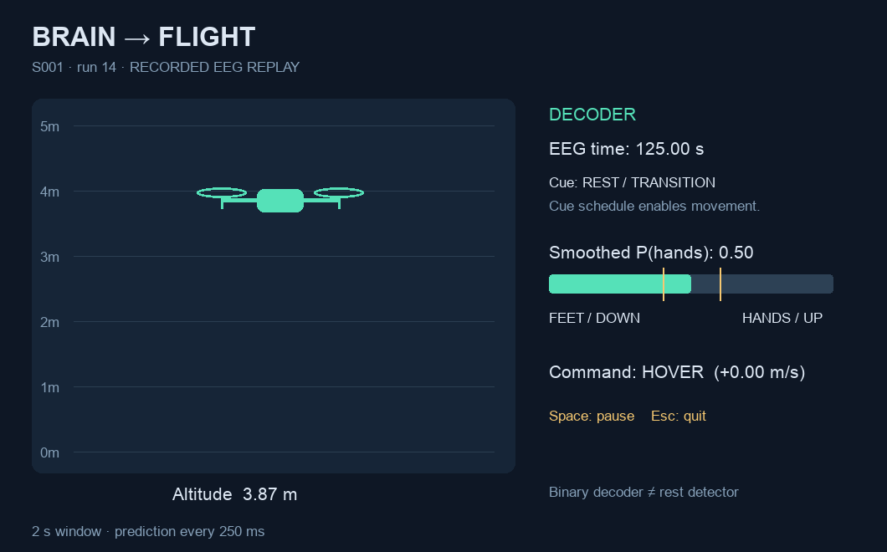
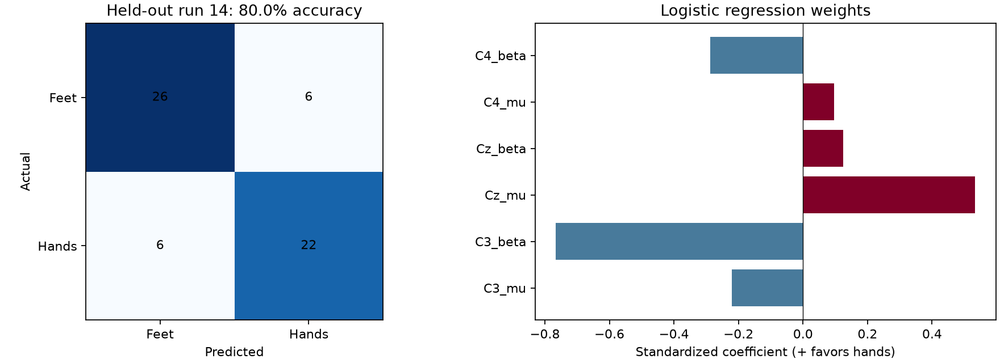

# EEG Drone

Reads recorded brain activity from someone imagining they are moving their hands or their feet, works out which one they were thinking about, and flies a simulated drone up or down based on the answer.



## The idea behind it

When you imagine moving part of your body, the brain rhythms over the matching patch of motor cortex get quieter. Imagining your hands quiets the areas on the left and right sides of your head. Imagining your feet quiets the area in the middle near the top. That difference is large enough to pick up with three electrodes, and large enough to build a crude control signal out of.

So the plan is simple. Measure how loud those rhythms are, train a model to tell the two patterns apart, and use whatever it says to steer something. Here that something is a drone that only moves on one axis. Hands sends it up, feet sends it down.

## What the data is

Everything comes from the PhysioNet Motor Movement/Imagery Database, a public set of recordings where 109 people sat in a lab and did this exact task. Each person went through several runs. This project trains on two of them and tests on a third that the model never gets to see during training.

Worth being clear about one thing up front. This is a recording being played back, not a live headset, and the drone is a few hundred lines of Python, not hardware. The playback does run in real time and the code never looks at future samples, so the decoding path is the same one you would need for a live stream. But nobody is wearing anything while it runs.

## How it works

**Load and filter.** Pull three channels (C3, Cz, C4) sampled 160 times a second. Run a bandpass filter that keeps 7 to 30 Hz and drops the slow drift from sweat and electrode movement along with the fast noise from muscle tension.

**Describe two seconds of signal using six numbers.** For each of the three channels, measure how much power sits in the mu band (8 to 12 Hz) and the beta band (13 to 30 Hz). Three channels times two bands is six numbers, and that is the entire input to the model. A two second window is 960 raw measurements, so this is a big reduction. It throws away timing and waveform shape, which vary randomly between trials, and keeps overall rhythm strength, which is the part that actually differs between hands and feet.

**Train a classifier.** Logistic regression. It learns six weights plus an offset, and outputs a probability that the person was imagining hands.

**Stream it.** During playback the data arrives in small chunks of about 50 ms. A buffer keeps the most recent two seconds, and the model produces a fresh prediction four times a second.

**Turn the probability into a command.** Smooth it first so a single noisy reading cannot jolt the drone. Then, above 0.6 go up, below 0.4 go down, and anything in between hover. That middle gap matters. When the model is unsure, doing nothing is better than twitching.

## Results

Trained on subject 1, runs 6 and 10. Tested on run 14, which the model never saw.

| Measure | Score |
| --- | --- |
| Accuracy on held out data | 80.0% |
| Balanced accuracy | 79.9% |
| Accuracy per trial | 86.7% |
| Baseline from always guessing the more common class | 53.3% |



The chart on the right is the interesting one. It shows what the model actually learned, and it lines up with the neuroscience without having been told to. The strongest weight pushing toward hands is mu power at Cz, the electrode over the foot area. The strongest weight pushing toward feet is beta power at C3, over the hand area. In both cases low power at an electrode means that region went quiet, which means that is the limb being imagined. The model found this on its own from 120 training examples and six features.

## Setup

Needs Python 3.11, 3.12 or 3.13.

```bash
python3 -m venv .venv
```

```bash
source .venv/bin/activate
```

```bash
pip install -e '.[dev]'
```

On Windows the activate step is `.venv\Scripts\activate` instead.

You need internet for the install and for the first run, which downloads about 7 MB of EEG.

## Running it

Download the recordings and plot the raw signal:

```bash
eeg-drone prepare --subject 1
```

Train the model and score it on held out data:

```bash
eeg-drone train --subject 1
```

Fly the drone. Space pauses, Escape quits:

```bash
eeg-drone fly
```

If you want the whole thing to run as fast as possible with no window:

```bash
eeg-drone fly --headless --speed 0
```

Everything the runs produce lands in `artifacts/`, including the trained model, the metrics as JSON, the plots, and a CSV with one row per prediction showing the probability, the command, and the altitude at that moment. That CSV is the best place to look if something seems off.

Run the tests with `pytest -q`, or `pytest -q --integration` to also download real data and check the full pipeline end to end.

## What is in here

| File | What it does |
| --- | --- |
| `src/eeg_drone/student.py` | Feature extraction, the classifier, and the probability to velocity mapping |
| `src/eeg_drone/data.py` | Downloads from PhysioNet, picks the three channels, reads the cue timings |
| `src/eeg_drone/signal.py` | The bandpass filter and the code that cuts training windows |
| `src/eeg_drone/training.py` | Trains, evaluates, saves the model and the plots |
| `src/eeg_drone/replay.py` | The streaming engine that makes predictions as data arrives |
| `src/eeg_drone/control.py` | Smoothing, gating, and the drone physics |
| `src/eeg_drone/simulator.py` | The Pygame window and the playback loop |
| `docs/` | Workshop notes, questions, and a writeup of the reference run |

## Things it does not do

The classifier only knows two things, hands and feet. It has no concept of rest, so if you show it someone sitting still it will still confidently pick one. The demo handles this by reading the cue schedule from the recording and only letting the drone move during known task periods. That is a real shortcut and the simulator says so on screen. Building something that works without cues would need a third class for rest, or a separate detector for whether the person is trying to do anything at all.

Latency is also worth understanding. Predicting four times a second is a refresh rate, not a reaction time. The buffer needs two full seconds of history, and there is a half second delay after each cue starts before a window counts, so the first command of a trial lands roughly two and a half seconds in.

Finally, the 80% number describes one person in one session. It says nothing about whether this would work on you, on a different day, or with a different headset. Getting there would mean retraining per person and testing on people the model has never seen.

## Where to go next

A few things that would make this better, roughly in order of payoff:

- Run it across many of the 109 subjects instead of one, and report a mean and spread rather than a single number
- Swap the fixed three channel setup for CSP, which learns a better channel mixture from the data
- Add a rest class and measure how often the drone moves when it should not
- Replace the file playback with a Lab Streaming Layer inlet so a real headset can feed it

## Credits

The EEG comes from the [PhysioNet EEG Motor Movement/Imagery Database](https://physionet.org/content/eegmmidb/1.0.0/) by Schalk et al., used under the Open Data Commons Attribution License. The recordings are downloaded at runtime and are not included here.

The project started from a teaching workshop that provides the data loading, filtering, replay and simulator code, with the feature extraction, classifier and control mapping left as exercises. Those three pieces live in `student.py` and are my implementation. Built with MNE, SciPy, scikit-learn and Pygame.
